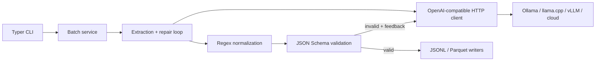

# SchemaForge

SchemaForge turns unstructured text into validated structured data through any
OpenAI-compatible `/v1/chat/completions` API. It combines guided JSON generation,
JSON Schema validation, deterministic normalization, and an automatic repair loop.
It supports single texts and fault-tolerant JSONL batches, with JSONL or Parquet output.

No model is trained or bundled. The same application works with Ollama, llama.cpp,
vLLM, or a cloud provider by changing environment variables only.

## Architecture



The package uses ports and adapters: `Extractor` depends on a small protocol rather
than a provider SDK. This keeps business logic testable and provider-independent.
Pydantic validates configuration and input/output records; JSON Schema validates the
dynamic extraction contract supplied by a user. Batch failures are data, so one bad
record does not terminate a long job. Logs go to stderr as JSON; command results go to
stdout or output files.

## Requirements

- Python 3.11–3.13 and [uv](https://docs.astral.sh/uv/), or Docker 24+
- An OpenAI-compatible model endpoint
- Up to 24 GB RAM; no GPU is required with a 4-bit Qwen2.5 model

## One-command demonstration

Start the recommended local model once:

```bash
ollama run qwen2.5:1.5b
```

Then install and demonstrate the main use case:

```bash
make install && make demo
```

Environment defaults already target Ollama at `http://localhost:11434/v1`. Override
them for any other compatible server:

```bash
export OPENAI_BASE_URL=https://provider.example/v1
export OPENAI_API_KEY=secret
export OPENAI_MODEL=Qwen/Qwen2.5-3B-Instruct
```

## CLI usage

Extract one record:

```bash
uv run schemaforge extract \
  "Ada Lovelace works at Analytical Engines Ltd. Email ADA@EXAMPLE.ORG." \
  --schema schemas/contact.json
```

Process JSONL into Parquet:

```bash
uv run schemaforge batch examples/contacts.jsonl data/contacts.parquet \
  --schema schemas/contact.json --format parquet
```

Input lines require a non-empty `text` field and may contain an `id`. Failed records
contain `ok=false` and an error, while processing continues. Use `schemaforge health`
to test API connectivity. Run `schemaforge --help` for all options.

## Development

```bash
uv sync --all-extras
uv run pytest -m "not slow"
uv run ruff format --check . && uv run ruff check .
uv run mypy src
uv run pre-commit install
```

Unit tests mock HTTP/model responses and enforce at least 70% branch-aware coverage.
The real-model integration test is opt-in:

```bash
RUN_SLOW_TESTS=1 uv run pytest -m slow
```

Build and run the container:

```bash
docker build -t schemaforge:local .
docker run --rm --add-host=host.docker.internal:host-gateway \
  schemaforge:local health
```

For mounted batch files, use Compose:

```bash
mkdir -p data
docker compose run --rm schemaforge batch /app/examples/contacts.jsonl \
  /app/data/contacts.parquet --schema /app/schemas/contact.json --format parquet
```

## Configuration

| Variable | Default | Purpose |
|---|---|---|
| `OPENAI_BASE_URL` | `http://localhost:11434/v1` | Compatible API root |
| `OPENAI_API_KEY` | `ollama` | Bearer token |
| `OPENAI_MODEL` | `qwen2.5:1.5b` | Provider model identifier |
| `LLM_TIMEOUT_SECONDS` | `60` | HTTP timeout |
| `LLM_MAX_RETRIES` | `2` | Repair attempts after the first call |
| `LOG_LEVEL` | `INFO` | Structured log level |

## Known limitations

- Structured-output dialects differ slightly. Ollama, recent llama.cpp/vLLM, and
  OpenAI-style providers accept `response_format`; an older server may need upgrading.
- JSON Schema `format` values are hints unless a format checker is configured.
- Parquet requires reasonably consistent field types across a batch. Very heterogeneous
  schemas should use JSONL output.
- Extraction quality depends on the selected model. Qwen2.5-1.5B is fast for demos;
  Qwen2.5-3B is generally more accurate while remaining CPU-friendly in 4-bit form.
- The CLI runs batch requests sequentially to avoid overwhelming local CPU servers.

## Release checklist

Before the deadline, merge to `main`, confirm CI is green, tag a release, and publish
the image (for example `docker buildx build --platform linux/amd64,linux/arm64 --push
-t DOCKERHUB_USER/schemaforge:1.0.0 .`). Verify the public repository and image from a
clean machine before the 10-minute live demonstration.

