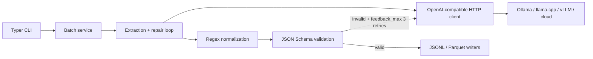

# SchemaForge

SchemaForge turns unstructured text into validated structured data through any
OpenAI-compatible `/v1/chat/completions` API. The selected scenario is vacancy
extraction. It combines few-shot prompting, guided JSON generation, Pydantic/JSON
Schema validation, deterministic normalization, and an automatic repair loop.
It supports single texts, asynchronous JSONL batches, checkpoints, evaluation metrics,
and JSONL or Parquet output.

No model is trained or bundled. The same application works with Ollama, llama.cpp,
vLLM, or a cloud provider by changing environment variables only.

## Architecture



The package uses ports and adapters: `Extractor` depends on a small protocol rather
than a provider SDK. This keeps business logic testable and provider-independent.
Pydantic validates configuration, vacancy fields, and input/output records. YAML or
JSON Schema files compile into dynamic Pydantic models, while JSON Schema is passed to
the model for guided decoding. Batch work uses `asyncio.Semaphore`, writes a checkpoint
by record ID, and can resume after a failure. Logs go to stderr as JSON; command results
go to stdout or output files.

## Requirements

- Python 3.11–3.13 and [uv](https://docs.astral.sh/uv/), or Docker 24+
- An OpenAI-compatible model endpoint
- Up to 24 GB RAM; no GPU is required with a 4-bit Qwen2.5 model

## One-command demonstration

Start the recommended local model once:

```bash
ollama run qwen2.5:1.5b
```

Then install and demonstrate the main use case:

```bash
make install && make demo
```

Environment defaults already target Ollama at `http://localhost:11434/v1`. Override
them for any other compatible server:

```bash
export OPENAI_BASE_URL=https://provider.example/v1
export OPENAI_API_KEY=secret
export OPENAI_MODEL=Qwen/Qwen2.5-3B-Instruct
```

## CLI usage

Extract one vacancy:

```bash
uv run schemaforge extract \
  "Ищем Python-разработчика в ООО Альфа. Зарплата 180000–240000 RUB." \
  --schema schemas/vacancy.yaml
```

Run an asynchronous batch with a checkpoint:

```bash
uv run schemaforge extract run \
  --schema vacancy \
  --in examples/vacancies.jsonl \
  --out data/vacancies.parquet \
  --format parquet \
  --concurrency 4 \
  --checkpoint data/vacancies.checkpoint.jsonl
```

Evaluate predictions against the checked-in gold sample:

```bash
uv run schemaforge extract eval \
  --schema vacancy \
  --in examples/vacancies.jsonl \
  --gold examples/vacancies_gold.jsonl
```

Generate a deterministic 500-record benchmark for the asynchronous pipeline:

```bash
uv run python scripts/generate_benchmark.py --count 500
uv run schemaforge extract run --schema vacancy \
  --in data/vacancies_500.jsonl --out data/vacancies_500.parquet \
  --format parquet --concurrency 4 --checkpoint data/vacancies_500.checkpoint.jsonl
```

The CLI supports four model-output modes:

1. `--mode free` asks for JSON in the prompt without a response-format constraint.
2. `--mode json` uses OpenAI-compatible JSON mode.
3. `--mode schema` uses guided JSON Schema decoding and is the default.
4. `--mode grammar` sends `LLAMA_CPP_GRAMMAR` to a llama.cpp-compatible server.

Print a generated Pydantic JSON Schema:

```bash
uv run schemaforge schema vacancy
```

Input lines require a non-empty `text` field and may contain an `id`. Failed records
contain `ok=false` and an error, while processing continues. Use `schemaforge health`
to test API connectivity. Run `schemaforge --help` for all options.

## Development

```bash
uv sync --all-extras
uv run pytest -m "not slow"
uv run ruff format --check . && uv run ruff check .
uv run mypy src
uv run pre-commit install
```

Unit tests mock HTTP/model responses and enforce at least 70% branch-aware coverage.
The real-model integration test is opt-in:

```bash
RUN_SLOW_TESTS=1 uv run pytest -m slow
```

Build and run the container:

```bash
docker build -t schemaforge:local .
docker run --rm --add-host=host.docker.internal:host-gateway \
  schemaforge:local health
```

For mounted batch files, use Compose:

```bash
mkdir -p data
docker compose run --rm schemaforge batch /app/examples/vacancies.jsonl \
  /app/data/vacancies.parquet --schema /app/schemas/vacancy.yaml --format parquet
```

## Configuration

| Variable | Default | Purpose |
|---|---|---|
| `OPENAI_BASE_URL` | `http://localhost:11434/v1` | Compatible API root |
| `OPENAI_API_KEY` | `ollama` | Bearer token |
| `OPENAI_MODEL` | `qwen2.5:1.5b` | Provider model identifier |
| `LLAMA_CPP_GRAMMAR` | unset | Optional GBNF grammar for `--mode grammar` |
| `LLM_TIMEOUT_SECONDS` | `60` | HTTP timeout |
| `LLM_MAX_RETRIES` | `2` | Repair attempts after the first call, maximum `3` |
| `LOG_LEVEL` | `INFO` | Structured log level |

## Known limitations

- Structured-output dialects differ slightly. Ollama, recent llama.cpp/vLLM, and
  OpenAI-style providers accept `response_format`; an older server may need upgrading.
- JSON Schema `format` values are hints unless a format checker is configured.
- Parquet requires reasonably consistent field types across a batch. Very heterogeneous
  schemas should use JSONL output.
- Extraction quality depends on the selected model. Qwen2.5-1.5B is fast for demos;
  Qwen2.5-3B is generally more accurate while remaining CPU-friendly in 4-bit form.
- Batch requests are bounded by `--concurrency`; a local CPU server should usually use
  a small value such as 2–4.
- Precision and recall are field-level metrics over the supplied gold JSONL file, not
  a replacement for a larger manually reviewed evaluation set.

## Release checklist

Before the deadline, merge to `main`, confirm CI is green, tag a release, and publish
the image (for example `docker buildx build --platform linux/amd64,linux/arm64 --push
-t DOCKERHUB_USER/schemaforge:1.0.0 .`). Verify the public repository and image from a
clean machine before the 10-minute live demonstration.

